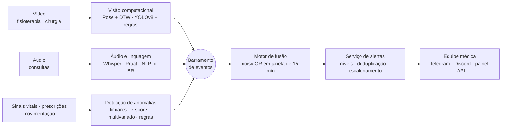

# Monitoramento multimodal de pacientes — Tech Challenge Fase 4

Sistema que monitora pacientes continuamente a partir de **vídeo, áudio, texto, sinais vitais, prescrições e movimentação**, detecta anomalias em cada fonte, **funde** os achados num escore de risco por paciente e **alerta a equipe médica** em tempo (quase) real.

Tudo roda localmente, em CPU e com **custo zero**: nenhuma chave de API, nenhum serviço pago. A troca da Azure por ferramentas open source foi acordada com o professor; a arquitetura é a mesma e cada serviço gerenciado tem um equivalente local (ver [relatório técnico](docs/relatorio_tecnico.md#3-tecnologias-e-equivalência-com-os-serviços-gerenciados)).



## Rodando em 3 comandos

```bash
pip install -r requirements.txt && pip install -e .
python scripts/run_demo.py          # gera outputs/relatorio_demo.html e os alertas
streamlit run dashboard/app.py      # painel da equipe (http://localhost:8501)
```

A demo simula um dia de internação com 4 pacientes e produz, em cerca de 2 min (com a avaliação):

| Saída | O que é |
| --- | --- |
| `outputs/relatorio_demo.html` | Relatório consolidado: alertas, risco por paciente, cada modalidade e métricas |
| `outputs/video/relatorio_fisioterapia_P00X.html` | Relatório automático da sessão de fisioterapia, com quadros-chave |
| `outputs/video/fisioterapia_P00X.mp4` | Vídeo do esqueleto anotado (vermelho = desvio) |
| `outputs/video/relatorio_cirurgia_P004.html` | Relatório automático do procedimento cirúrgico |
| `outputs/audio/analise_P00X.json` | Transcrição, features acústicas, voz e NLP de cada consulta |
| `outputs/alerts.json` · `alerts.jsonl` | Alertas emitidos (com histórico e reconhecimento) |
| `outputs/events.jsonl` · `assessments.jsonl` | Trilha de auditoria: todos os eventos e avaliações de risco |
| `outputs/metrics.json` | Precisão, recall e F1 de cada detector |

Para gravar o vídeo de apresentação, `python scripts/run_demo.py --realtime 1 --skip-eval` faz o replay com pausa entre os eventos e mostra os alertas chegando no terminal.

## Estrutura

```
src/hospital_monitor/
├── events.py · bus.py · config.py     contrato de evento, barramento pub/sub, limiares
├── video/      pose.py (MediaPipe, YOLOv8-pose, OpenPose/JSON) · kinematics.py (ângulos, DTW)
│               exercise_analyzer.py · surgical.py (YOLOv8 + regras) · render.py · report.py
├── audio/      transcribe.py (Whisper local) · acoustic.py (Praat) · voice_analyzer.py
│               clinical_nlp.py (termos, negação, sentimento) · pipeline.py
├── anomaly/    vitals.py (streaming) · prescriptions.py · movement.py · metrics.py
├── fusion/     engine.py (fusão tardia, noisy-OR)
├── alerts/     manager.py (dedupe, escalonamento, reconhecimento) · notifiers.py
├── api/        app.py (FastAPI)
├── data/       synthetic.py (dados rotulados) · physionet.py (dados reais)
└── orchestrator.py · services.py · evaluation.py
scripts/        run_demo.py · evaluate.py · train_models.py · analyze_video.py · analyze_audio.py · download_physionet.py
dashboard/      app.py (Streamlit)
tests/          29 testes (pytest)
docs/           relatorio_tecnico.md · roteiro_video.md
```

## Usando com dados reais

```bash
pip install -r requirements-ml.txt                                   # Whisper, YOLOv8, MediaPipe, pysentimiento

python scripts/analyze_video.py referencia execucao_correta.mp4      # grava o padrão do exercício
python scripts/analyze_video.py fisio sessao.mp4 --patient P010      # pose → desvios → relatório
python scripts/analyze_video.py cirurgia video.mp4 --weights models/surgical_yolov8n.pt
python scripts/analyze_audio.py consulta.wav --patient P010          # Whisper → voz → NLP
python scripts/download_physionet.py --records 1 2 3 --inject desaturation   # BIDMC (PhysioNet)
```

O detector de cirurgia precisa de pesos YOLOv8 treinados em instrumental cirúrgico (ex.: fine-tuning em m2cai16-tool ou Cholec80); as regras de segurança funcionam com qualquer modelo que produza as classes configuradas.

## API e serviços

```bash
uvicorn hospital_monitor.api.app:app --reload      # documentação interativa em http://localhost:8000/docs
docker compose up --build                          # demo + API (:8000) + painel (:8501) + Redis
```

Endpoints: `POST /vitals` (streaming, 1 amostra por chamada), `POST /analyze/audio`, `POST /analyze/exercise`, `POST /analyze/prescriptions`, `POST /events`, `GET /alerts`, `POST /alerts/{id}/ack`, `GET /patients/{id}/risk`.

Notificações externas: copie `.env.example` para `.env` e preencha `TELEGRAM_BOT_TOKEN` + `TELEGRAM_CHAT_ID` ou `DISCORD_WEBHOOK_URL`.

## Testes

```bash
pytest -q
```

## Aviso

Projeto acadêmico. Os dados da demo são 100% sintéticos e nenhum dado real de paciente é versionado. O sistema apoia a decisão clínica e não a substitui.
