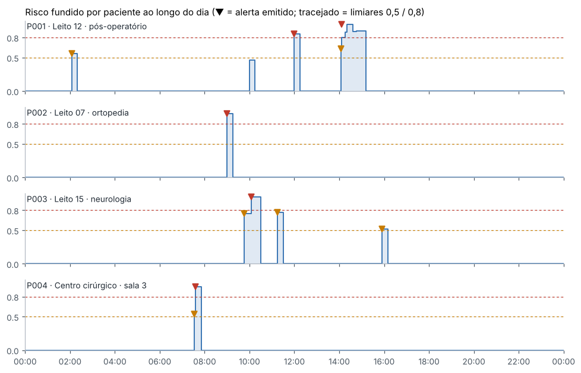
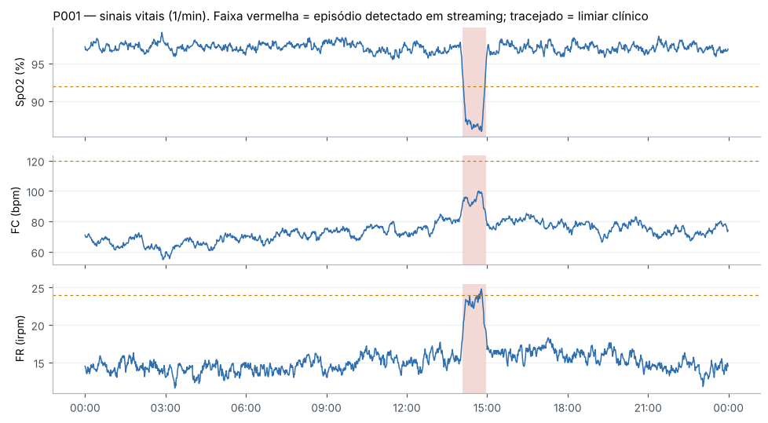

# Relatório técnico — Monitoramento multimodal de pacientes

**Tech Challenge — Fase 4 · Pós-graduação em IA para Devs**

## 1. Resumo

O hospital já usa IA para laudos e exames e agora quer monitorar pacientes continuamente com dados de vídeo, áudio e texto, além de sinais vitais, prescrições e movimentação. Construímos uma solução em que cada tipo de dado tem um pipeline próprio de detecção de anomalias. Os pipelines publicam eventos num formato comum, um motor de fusão combina os eventos por paciente numa janela de 15 minutos e um serviço de alertas notifica a equipe com deduplicação e escalonamento.

Na demonstração (um dia simulado com 4 pacientes), o sistema gerou **24 eventos** e **11 alertas** (5 críticos e 6 de atenção). Ele suprimiu 8 duplicados e emitiu 1 atualização quando uma nova modalidade confirmou um alerta já aberto. Nos dados sintéticos rotulados, o detector combinado de sinais vitais encontrou **100% dos episódios**, sem falsos episódios, com atraso médio de 8,9 min. Os detectores de vídeo encontraram todos os desvios de execução e todas as quedas, sem quedas falsas.

Toda a solução roda localmente em CPU, com ferramentas gratuitas, conforme alinhado com o professor (a Azure deixou de ser obrigatória).

## 2. Fluxo multimodal



1. **Ingestão.** Vídeos (fisioterapia, cirurgia, quarto), áudios de consulta, séries de sinais vitais a 1 amostra/min, histórico de prescrições e atividade no leito a cada 5 min.
2. **Pipelines por modalidade.** Cada pipeline extrai features, aplica seus detectores e emite um `Event` quando encontra algo anormal. Os pipelines não se conhecem; só compartilham o contrato de evento.
3. **Barramento.** `InMemoryBus` na demo e nos testes; `RedisStreamBus` (Redis Streams) quando os serviços rodam separados no `docker compose`.
4. **Fusão.** O `RiskFusionEngine` mantém a janela de 15 min de cada paciente e recalcula o risco a cada evento.
5. **Alertas.** O `AlertManager` decide se notifica, anexa a um alerta aberto, atualiza ou escalona. Os notificadores entregam ao console, arquivo, Telegram, Discord, painel Streamlit e API.
6. **Reconhecimento.** A equipe reconhece o alerta no painel ou via `POST /alerts/{id}/ack`, e o reconhecimento fica na trilha de auditoria.

**Contrato de evento** (`src/hospital_monitor/events.py`):

```json
{
  "patient_id": "P003", "modality": "audio", "kind": "voz_disartria",
  "anomaly_score": 0.90, "severity": "critical", "timestamp": "2026-10-28T10:05:00-03:00",
  "description": "Voz com sinais compatíveis com disartria (instabilidade vocal, ritmo irregular).",
  "evidence": {"drivers": ["jitter_pct: z=+12.7", "shimmer_pct: z=+10.9", "hnr_db: z=-5.4"]},
  "source": "audio.voice_analyzer", "event_id": "…"
}
```

**Tempo real.** O detector de sinais vitais é *streaming*: avalia cada amostra no momento em que chega (endpoint `POST /vitals`) e reemite episódios em curso a cada 10 min, para a fusão saber que o problema continua. A demo faz *replay* dos eventos em ordem cronológica pelo mesmo barramento. A janela da fusão usa o relógio dos eventos, o que torna o replay determinístico e testável.

## 3. Tecnologias e equivalência com os serviços gerenciados

| Função | Sugerido no enunciado | Usado no projeto (gratuito) |
| --- | --- | --- |
| Transcrição | Azure Speech to Text | faster-whisper (Whisper local, pt-BR) |
| Termos clínicos | Azure Text Analytics for Health | Léxico clínico pt-BR + negação estilo NegEx |
| Sentimento | Azure Text Analytics | pysentimiento (BERTweet-pt) ou léxico próprio |
| Pose | OpenPose | MediaPipe Pose (3D) ou YOLOv8-pose; aceita JSON do OpenPose |
| Objetos | YOLOv8 | YOLOv8 (Ultralytics) + motor de regras |
| Voz | — | Praat (parselmouth): jitter, shimmer, HNR |
| Anomalias | — | scikit-learn, SciPy |
| Mensageria | — | Redis Streams |
| Alertas | — | Bot do Telegram, webhook do Discord |
| Painel e API | — | Streamlit, FastAPI |

Os modelos pré-treinados (Whisper, YOLOv8, MediaPipe, pysentimiento) são opcionais (`requirements-ml.txt`). Sem eles, a solução usa transcrição *sidecar*, keypoints já extraídos e sentimento por léxico, o que permite rodar testes e CI sem baixar pesos.

## 4. Modelos aplicados em cada tipo de dado

### 4.1 Vídeo de fisioterapia — pose + cinemática + DTW

1. **Pose** → 17 keypoints COCO por frame. O MediaPipe fornece coordenadas 3D em metros, o que permite medir assimetria e valgo; YOLOv8-pose e OpenPose fornecem 2D.
2. **Limpeza.** Frames sem detecção são preenchidos por interpolação linear e o sinal é suavizado com Savitzky-Golay.
3. **Cinemática.** Ângulos de joelho e quadril, inclinação do tronco e valgo dinâmico (deslocamento medial do joelho em cm).
4. **Segmentação de repetições.** Cada vale do ângulo do joelho (proeminência ≥ 25°) é uma repetição.
5. **Comparação com o padrão.** Uma execução correta gera a referência: curva média de 50 pontos, ROM de 95°, tronco máximo de 25° e DTW médio de 11,5 ± 3,4°. Cada repetição é comparada a essa referência.

| Desvio | Regra | Interpretação clínica |
| --- | --- | --- |
| Amplitude reduzida | ROM < 70% da referência | Agachamento raso, dor ou fraqueza |
| Assimetria | \|joelho E − joelho D\| > 15° | Descarga de peso desigual |
| Valgo dinâmico | Joelho > 4 cm medial | Risco de lesão ligamentar |
| Inclinação do tronco | > referência + 20° | Compensação |
| Padrão atípico | DTW > média + 4σ | Movimento diferente do esperado |
| Queda | Centro de massa cai > 0,30 m em 1 s e o corpo fica horizontal | Evento sentinela |

Desvios de execução recebem escore entre 0,50 e 0,75. Eles vão para o relatório da fisioterapia, mas sozinhos não chamam a equipe médica. A queda recebe 0,95 e é tratada como evento sentinela.

### 4.2 Vídeo cirúrgico — YOLOv8 + regras de segurança

O YOLOv8 detecta instrumentos, gazes e mãos por frame. Um motor de regras, independente do modelo, gera três tipos de achado:

- instrumento fora do campo estéril por ≥ 10 s;
- campo sem visibilidade (nenhuma detecção) por ≥ 5 s;
- contagem de gazes no fim menor que no início. A contagem usa o percentil 90 numa janela de 30 s, para tolerar falhas de detecção. Esse achado é crítico, pois indica possível retenção de material (protocolo de cirurgia segura da OMS).

### 4.3 Áudio — transcrição, voz e linguagem

- **Transcrição:** Whisper local com timestamps.
- **Features acústicas (Praat):** jitter, shimmer, HNR, variação de f0 em semitons, intensidade, sílabas/s (método de de Jong & Wempe), irregularidade do ritmo, pausas, sílabas por frase e inspirações audíveis por minuto.
- **Desvio do normal:** cada feature vira z-score contra um perfil de falantes saudáveis, que pode ser trocado pelo baseline do próprio paciente. Cada condição soma os desvios na direção clinicamente esperada:
  - **fadiga:** ↑ pausas, ↓ velocidade, ↓ intensidade;
  - **disartria:** ↑ jitter, ↑ shimmer, ↓ HNR, ↑ irregularidade;
  - **dispneia:** ↑ inspirações, ↓ sílabas por frase.

  O resultado é explicável: o evento lista as features que mais desviaram.
- **Classificador:** Random Forest (300 árvores) sobre as mesmas features, para o diagnóstico diferencial.

### 4.4 Texto — NLP clínico em português

- **Termos clínicos:** dicionário com 18 conceitos (8 sinais de alarme, como dor torácica, dispneia, síncope, disartria e déficit motor) e 78 variantes, com normalização de acentos.
- **Negação e incerteza:** no estilo NegEx, com janela de 6 tokens e terminadores ("mas", "porém"). Assim, "não tenho falta de ar, mas sinto dor no peito" gera apenas dor torácica.
- **Sentimento:** pysentimiento quando instalado; senão, um léxico com intensificadores e negação.
- **Escore do evento:** termo afirmado mais grave, mais 0,05 por termo adicional, mais 0,05 se o sentimento for muito negativo.

### 4.5 Sinais vitais — três detectores em streaming

| Detector | O que captura | Como |
| --- | --- | --- |
| Limiares clínicos | Valores perigosos (SpO2 < 92%, FC > 120 bpm, PAS < 100 mmHg…) | Faixas inspiradas no NEWS2 |
| Desvio do baseline | Mudança relevante para *aquele* paciente | z-score robusto (mediana/MAD) em janela de 4 h. O baseline não aprende com amostras anômalas e o desvio só conta fora da faixa "sem alerta" do NEWS2 |
| Multivariado | Deterioração silenciosa: vários sinais piorando juntos sem cruzar limiar | Soma dos z² na direção ruim → p-valor qui-quadrado (p < 10⁻⁶ e ≥ 3 sinais) |

O Isolation Forest (scikit-learn) foi avaliado como alternativa não supervisionada (ver resultados).

### 4.6 Prescrições — regras farmacológicas + Isolation Forest

**Regras:**

- erro de dose de 10× (dose 8–12× a anterior);
- dose diária acima do máximo de referência;
- duplicidade terapêutica em classes de alto risco (anticoagulantes, opioides);
- mudança abrupta (dose diária ≥ 3× ou ≤ 1/3 da anterior).

O Isolation Forest, treinado com o histórico de 40 pacientes, apenas *anota* padrões incomuns com escore 0,45, abaixo do limiar de alerta (ver 6.2).

### 4.7 Movimentação durante a internação

A atividade vem de acelerômetro ou da energia de movimento do vídeo do quarto (diferença entre frames, `motion_energy`). Três regras:

- **imobilidade:** ≥ 2 h acordado com atividade < 3. Indica risco de lesão por pressão ou rebaixamento de consciência;
- **agitação noturna:** média de 30 min > 3× o baseline noturno do paciente. Indica risco de delirium e queda;
- **queda:** pico abrupto seguido de imobilidade.

## 5. Fusão e alertas

**Fusão tardia por noisy-OR ponderado.** Em cada modalidade vale o evento mais grave da janela:

```latex
\text{risco} = 1 - \prod_{m} (1 - w_m \, s_m) \; + \; 0{,}15 \cdot (\text{modalidades concordantes} - 1)
```

| Modalidade | Peso |
| --- | --- |
| Sinais vitais | 1,0 |
| Prescrição | 0,9 |
| Relato (texto) | 0,8 |
| Movimentação | 0,8 |
| Voz | 0,7 |
| Vídeo | 0,7 |

Começamos com média ponderada (plano inicial) e trocamos por noisy-OR. Na média, modalidades normais "diluem" um achado grave: uma dessaturação crítica com vídeo e voz normais cairia para nível de atenção. No noisy-OR, um sinal forte sozinho já basta, e a concordância entre modalidades aumenta o risco. Eventos sentinela (queda, gaze não contabilizada) não são atenuados pelo peso da modalidade.

**Níveis:** atenção a partir de 0,5; crítico a partir de 0,8.

**Política anti-fadiga de alertas:**

1. dentro de 30 min, eventos do mesmo nível são *anexados* ao alerta aberto, sem nova notificação;
2. evidência de uma *nova modalidade* gera uma notificação de atualização;
3. escalonamento de atenção para crítico sempre notifica e marca o alerta anterior como `escalated`;
4. eventos simultâneos do mesmo paciente (voz e texto da mesma consulta) geram uma única avaliação.

## 6. Resultados

### 6.1 Exemplos de anomalias detectadas na demo

| Hora | Paciente | Nível | O que aconteceu |
| --- | --- | --- | --- |
| 02:05 | P001 | Atenção | Agitação noturna de 1,7 h → risco de delirium |
| 07:32 → 07:35 | P004 | Atenção → crítico | Bisturi fora do campo estéril por 45 s; câmera obstruída por 9 s. No fim, 5 gazes no início e 4 no fim |
| 09:00 | P002 | Crítico | Queda durante a fisioterapia, aos 11,6 s da sessão |
| 09:45 → 10:05 | P003 | Atenção → crítico (risco 1,00) | Taquicardia (até 135 bpm). Na consulta das 10:05, a voz mostra disartria (jitter z = +12,7, shimmer z = +10,9, HNR z = −5,4; RF 99%) e o relato afirma fala enrolada, fraqueza no braço e rosto dormente. A febre foi corretamente negada. Quadro compatível com AVC |
| 11:15 | P003 | Atenção | Heparina prescrita com enoxaparina ativa (duplicidade de anticoagulante) |
| 12:00 | P001 | Crítico | Enoxaparina 400 mg (10× a dose anterior de 40 mg) |
| 14:05 → 14:06 | P001 | Atenção → crítico | Deterioração combinada e depois dessaturação (SpO2 86%, FR 24,8 irpm) |
| 14:10 | P001 | — | Alerta reconhecido pela enfermagem |
| 14:20 | P001 | Atualização (risco 1,00) | Na consulta, a voz mostra dispneia (34 inspirações/min, 1,1 sílaba por frase) e o relato inclui falta de ar e pressão no peito, com sentimento negativo |
| 15:55 | P003 | Atenção | Imobilidade de 3 h no leito |

A assimetria de P001 na fisioterapia (2 de 6 repetições, 26° de diferença E/D) ficou no relatório da sessão. O evento teve escore 0,66 e risco fundido 0,46 (peso 0,7 do vídeo), abaixo do limiar de alerta, então não chamou a equipe médica. O paciente P002 (consulta normal, negando sintomas) não gerou evento de áudio.



### 6.2 Avaliação quantitativa

Os dados são sintéticos e rotulados, com seeds fixos. Reproduza com `python scripts/evaluate.py`.

**Sinais vitais** — 10 séries de 24 h com 5 anomalias cada (taquicardia, hipotensão, dessaturação, deterioração silenciosa e febre):

| Detector | Precisão | Recall | F1 | Recall por episódio | Atraso médio | Falsos episódios/dia |
| --- | --- | --- | --- | --- | --- | --- |
| Limiares clínicos | 1,00 | 0,43 | 0,60 | 0,80 | 8,9 min | 0,0 |
| Desvio do baseline | 1,00 | 0,74 | 0,85 | 1,00 | 9,8 min | 0,0 |
| Multivariado | 1,00 | 0,42 | 0,59 | 0,48 | 16,0 min | 0,0 |
| **Combinado (adotado)** | **1,00** | **0,77** | **0,87** | **1,00** | **8,9 min** | **0,0** |
| Isolation Forest | 0,42 | 0,90 | 0,57 | 1,00 | 1,3 min | 22,6 |

Os limiares sozinhos perdem a deterioração silenciosa (recall por episódio de 0,80). O Isolation Forest é o mais rápido, mas gera 22,6 falsos episódios por dia, o que é inviável numa enfermaria. A combinação mantém a precisão dos limiares e o recall do baseline. Em 10 séries normais extras, o detector combinado não gerou nenhum falso episódio.

**Prescrições** — 140 prescrições, 40 anômalas:

| Método | Precisão | Recall | F1 |
| --- | --- | --- | --- |
| Regras | 1,00 | 1,00 | 1,00 |
| Isolation Forest isolado | 0,83 | 0,50 | 0,63 |

O Isolation Forest sinaliza a *correção* de um erro como incomum e não separa ajustes rotineiros de erros. Por isso ele só anota, sem alertar.

**Movimentação** — 10 séries de 48 h: precisão e recall por episódio de 1,00, atraso médio de 3,1 min e 0 falsos alarmes em 10 séries normais.

**Fisioterapia** — 8 sessões por tipo de desvio:

| Desvio | Recall por repetição |
| --- | --- |
| Amplitude reduzida | 1,00 |
| Assimetria | 1,00 |
| Valgo | 1,00 |
| Inclinação do tronco | 1,00 |

Das repetições normais, 4 de 128 (3%) foram marcadas indevidamente. Quedas: 8 de 8 detectadas e 0 de 8 falsas.

**Cirurgia** — 5 vídeos com falhas: 5 de 5 para cada tipo de falha (instrumento fora do campo, campo sem visibilidade, contagem de gazes) e 0 achados em 5 vídeos normais.

**NLP clínico** — 20 frases com negação: 20 de 20 termos e 20 de 20 negações corretas.

**Voz (Random Forest)** — validação cruzada 5-fold em 120 vozes (4 classes): acurácia de 1,00. As features mais importantes foram jitter, shimmer, pausa média, sílabas/s e HNR.

### 6.3 Validade dos números

Os números acima validam a **implementação e a integração**, não o desempenho clínico. Os dados sintéticos foram gerados com as mesmas famílias de anomalia que os detectores procuram. Por isso as regras de prescrição e o classificador de voz chegam a 100%: as classes sintéticas são separáveis por construção.

A validação clínica exigiria:

- sinais vitais reais do PhysioNet: BIDMC (aberto), já suportado por `scripts/download_physionet.py`, ou MIMIC-IV (com credenciamento);
- vozes com disartria rotulada: TORGO, UA-Speech;
- vídeos de fisioterapia gravados com consentimento e rotulados por fisioterapeutas;
- um YOLOv8 com fine-tuning em instrumental cirúrgico (m2cai16-tool, Cholec80).

Em dados reais, esperamos acurácia de voz bem abaixo de 100%, porque disartria e fadiga se sobrepõem. Também esperamos mais falsos alarmes em sinais vitais, por causa de artefatos de sensor.

## 7. Limitações, ética e LGPD

- **Apoio, não substituição.** Os alertas trazem as evidências que os geraram (valores, termos, features) para que o profissional decida.
- **Dados.** Nenhum dado real de paciente é versionado. A demo é 100% sintética, e gravações reais exigem consentimento. Os IDs de paciente são pseudônimos.
- **Explicabilidade.** Optamos por detectores explicáveis (regras, z-scores, DTW) nos pontos de decisão. O Random Forest e o Isolation Forest são complementares.
- **Viés.** O léxico clínico cobre o português do Brasil formal e coloquial comum, mas não regionalismos. Os perfis de voz devem ser calibrados por sexo e idade, ou pelo baseline do próprio paciente.
- **Vídeo 2D.** Assimetria e valgo dependem do ângulo da câmera; recomendamos câmera lateral ou pose 3D (MediaPipe).

## 8. Trabalhos futuros

- Integração com prontuário via HL7 FHIR (Observation, MedicationRequest, Flag).
- Baseline de voz por paciente na admissão.
- LLM local (Ollama) para resumir o alerta em linguagem natural.
- Calibração dos pesos da fusão com dados rotulados (regressão logística sobre os escores).
- Fine-tuning do YOLOv8 em instrumental cirúrgico.

## 9. Como reproduzir

```bash
pip install -r requirements.txt && pip install -e .
python scripts/run_demo.py      # demo + relatórios + métricas em outputs/
pytest -q                       # testes
streamlit run dashboard/app.py  # painel
```
